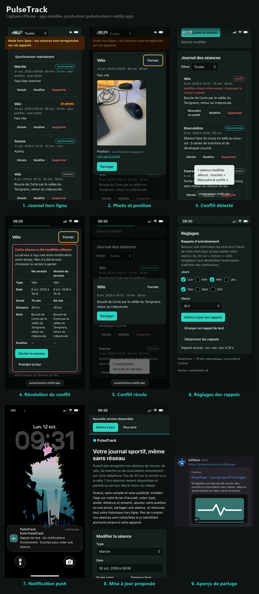
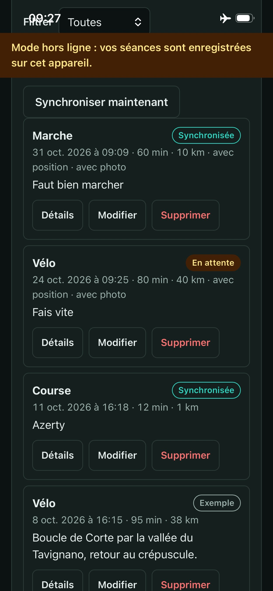
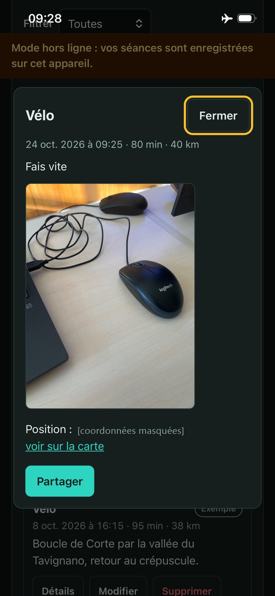
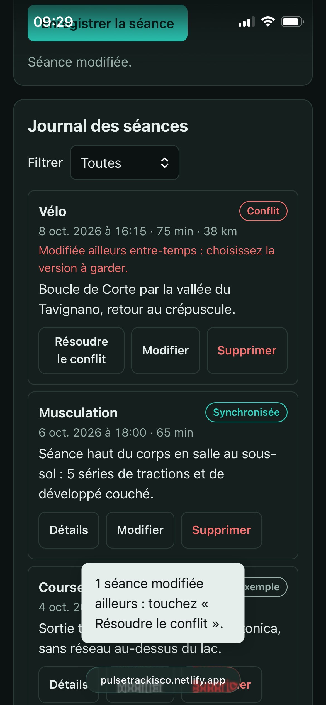
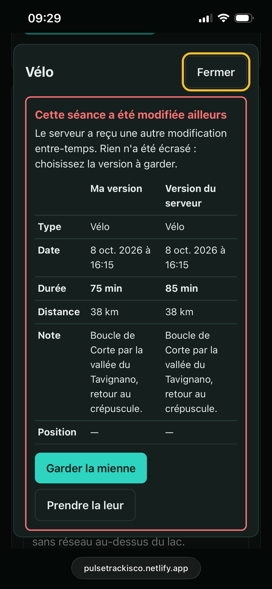
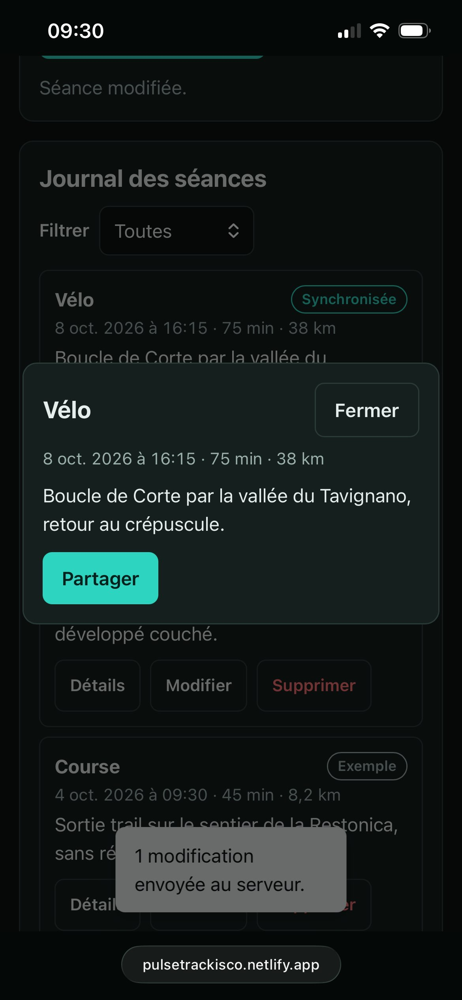
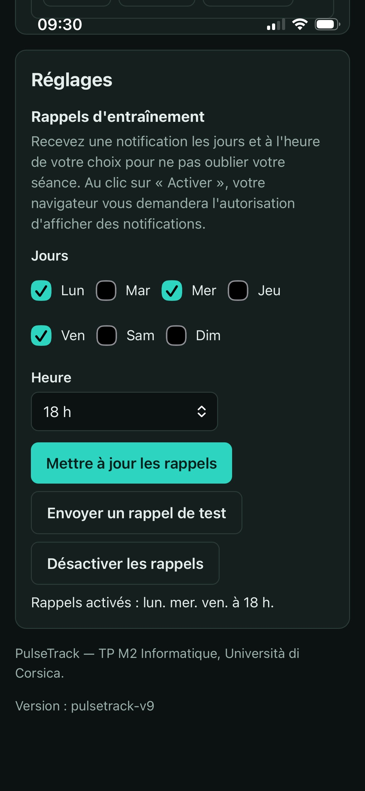
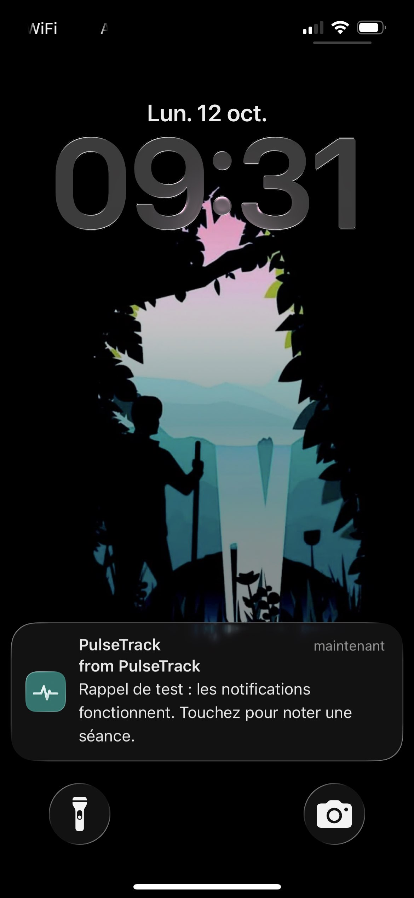
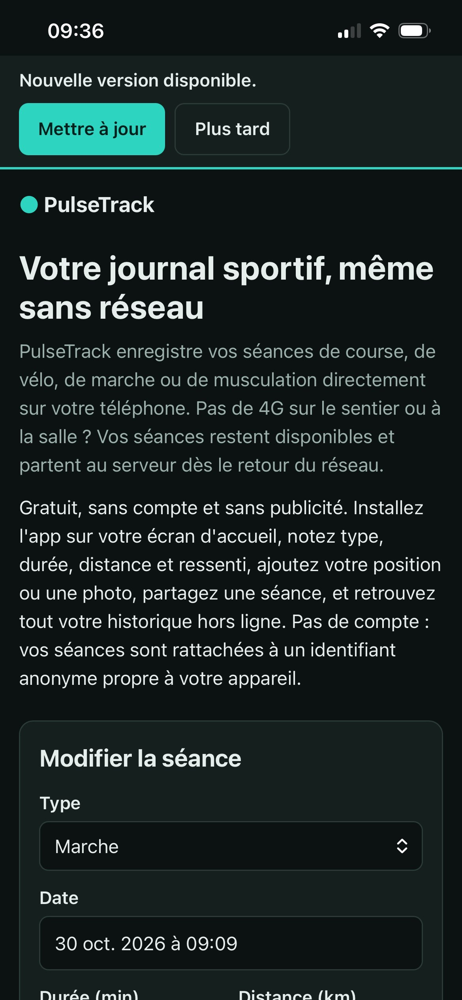
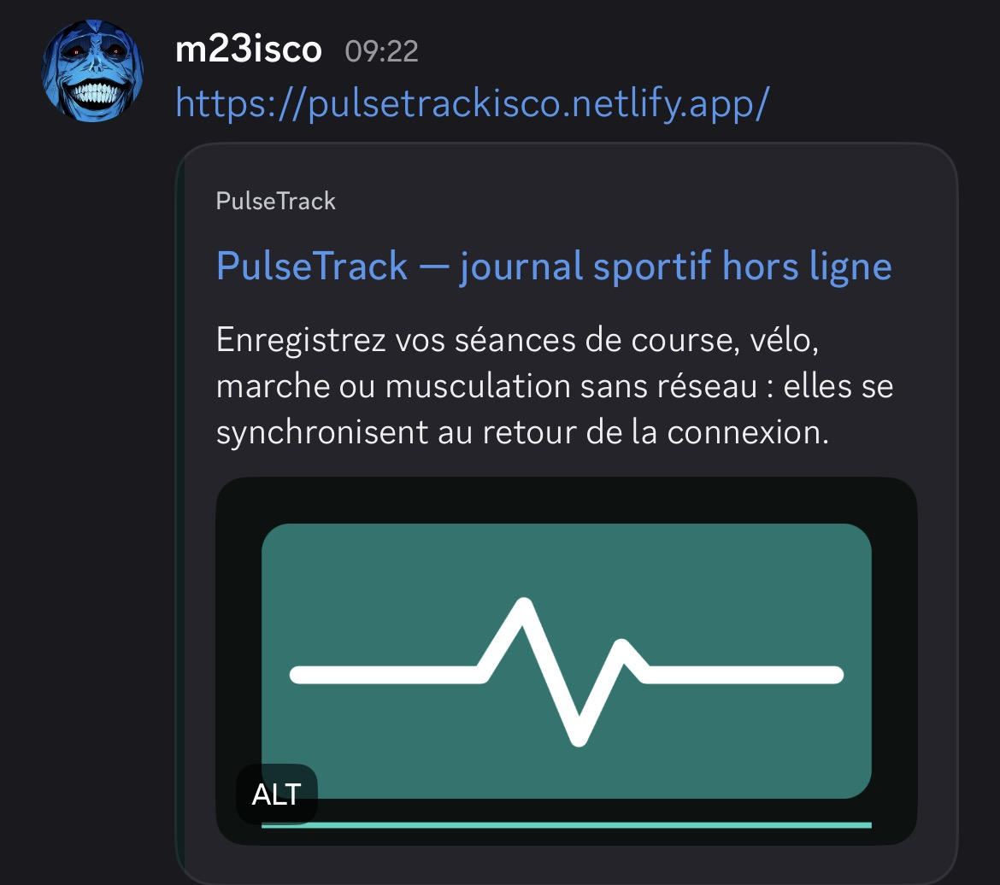

# PulseTrack — captures iPhone

App installée sur l'écran d'accueil, production (<https://pulsetrackisco.netlify.app>), 12 octobre 2026. Détail des tests : [DOC-TECHNIQUE.md § 11.4](../../DOC-TECHNIQUE.md#114-tests-manuels-sur-téléphone-iphone-safari).

| | |
| --- | --- |
| **1. Journal hors ligne** — bandeau hors ligne, séance « En attente » | **2. Photo et position** — détail hors ligne, partage (coordonnées masquées) |
|  |  |
| **3. Conflit détecté** — badge et message après le 412 | **4. Résolution du conflit** — « Garder la mienne » / « Prendre la leur » |
|  |  |
| **5. Conflit résolu** — modification envoyée au serveur | **6. Réglages des rappels** — jours et heure |
|  |  |
| **7. Notification push** — rappel reçu sur l'écran verrouillé | **8. Mise à jour proposée** — bannière pendant une modification |
|  |  |
| **9. Aperçu de partage** — carte Open Graph dans Discord | |
|  | |
